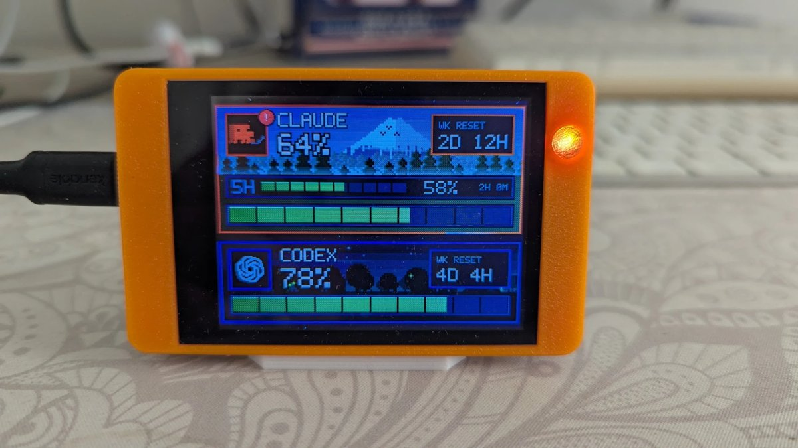
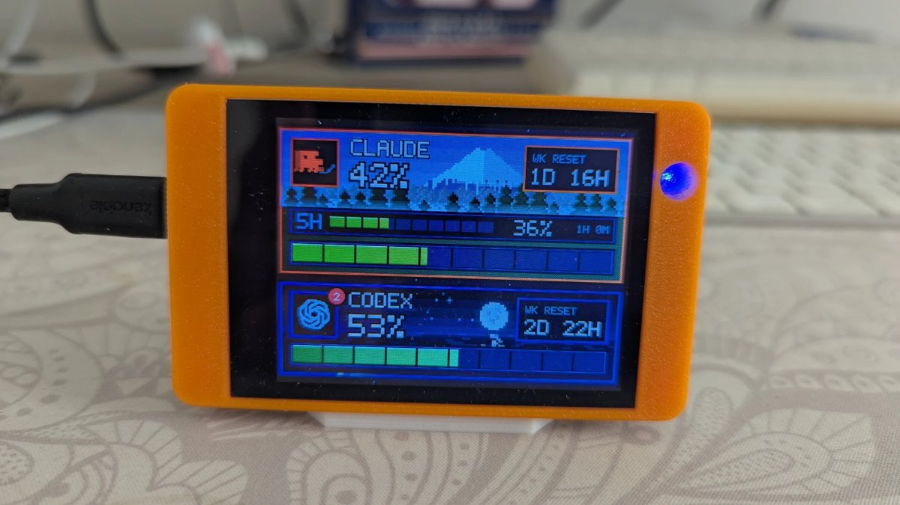
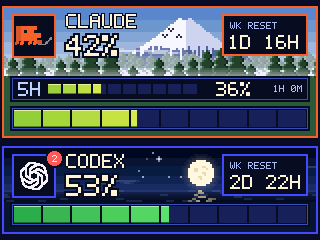
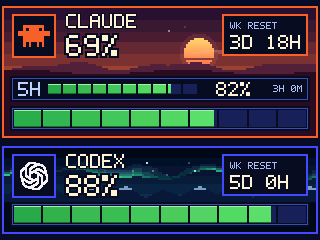
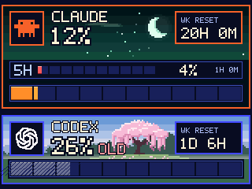
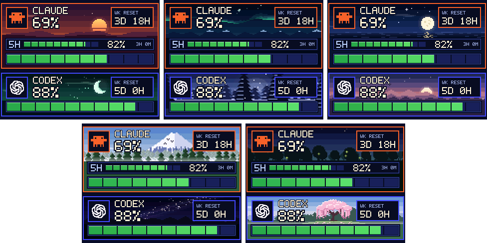

<h1 align="center">Agent Tap Screen</h1>

<p align="center">A touch screen on your desk that shows when Claude or Codex needs you. Tap it to jump to that chat.</p>

<p align="center">
  
  
</p>

For the **Claude desktop app** and **Codex in the ChatGPT desktop app**, on macOS. Terminal sessions aren't tracked.

## Tap to focus

- **Waiting:** a light runs round the card and a badge shows how many chats need you. Tap to open the oldest.
- **Working:** Clawd types on his laptop, the ChatGPT knot spins. Tap to open it; tap again to cycle.
- **Idle:** tap to bring the app to the front.
- **LED:** breathes the app's colour while anything waits.

<p align="center"></p>

## Usage at a glance

- **Claude:** weekly limit left, 5-hour limit in the thin bar.
- **Codex:** weekly limit left.
- Bars drain green → red. `OLD` after 15 min without a reading; `--` when unknown, never 0%.

<p align="center">
  
  
</p>

## Scenes

- Ten animated pixel backdrops; a new pair each day.
- Double-tap a card for the next one.

<p align="center"></p>

## Setup

You need:
- a JC2432W328C board (ESP32, 2.8" 320×240 capacitive touch) and a USB-A→C cable;
- a Mac with the Claude and/or ChatGPT desktop app;
- Claude Code signed in.

The easiest way is to let an agent do it. Clone the repo, plug in the board, and paste this into Claude Code or Codex:

> Set up this repo for me. Read README.md and AGENTS.md, flash the firmware to the board on USB, install the
> bridge LaunchAgent, add the Claude Code and Codex hooks, then take a screenshot to check it works.

<details>
<summary>By hand</summary>

1. Flash: `brew install platformio && cd firmware && pio run -t upload --upload-port /dev/cu.usbserial-*`
2. Check readings: `python3 bridge/usage_bridge.py --once`
3. Run at login: `launchd/install.sh` (log: `~/Library/Logs/usage-screen.log`)
4. Hooks:
   - Claude (`~/.claude/settings.json`): `Stop` and `Notification` → `hook.py claude wait`; `UserPromptSubmit`,
     `PreToolUse` and `PostToolUse` → `hook.py claude work`; `SessionEnd` → `hook.py claude clear`.
   - Codex: `python3 bridge/add_codex_hooks.py`, then approve the hooks in Codex.

Stop the bridge before flashing or `bridge/screenshot.py` (it holds the serial port):
`launchctl bootout gui/$(id -u)/local.usage-screen`, then `launchd/install.sh` to start it again.
</details>

## How it works

```
agent hooks ──► ~/.cache/usage-screen/{working,waiting}/ ──┐
usage APIs ────────────────────────────────────────────────┼─► bridge (LaunchAgent) ──USB──► ESP32
                       open claude:// / codex:// ◄─────────┘◄──── tap ◄────────────────────┘
```

- `bridge/usage_bridge.py` polls usage, watches the hook folders, sends the screen one JSON line, opens chats on tap.
- `bridge/hook.py` is the agent hook. It never blocks: silent, always exits 0.
- `firmware/` draws everything.

## Credits

The look started from [token-tv](https://github.com/click6067-ship-it/token-tv)'s Pixel Retro face and has since
diverged; the 5×7 font is still theirs (MIT). Clawd and the ChatGPT knot are read from the installed apps.
Not affiliated with Anthropic or OpenAI.
